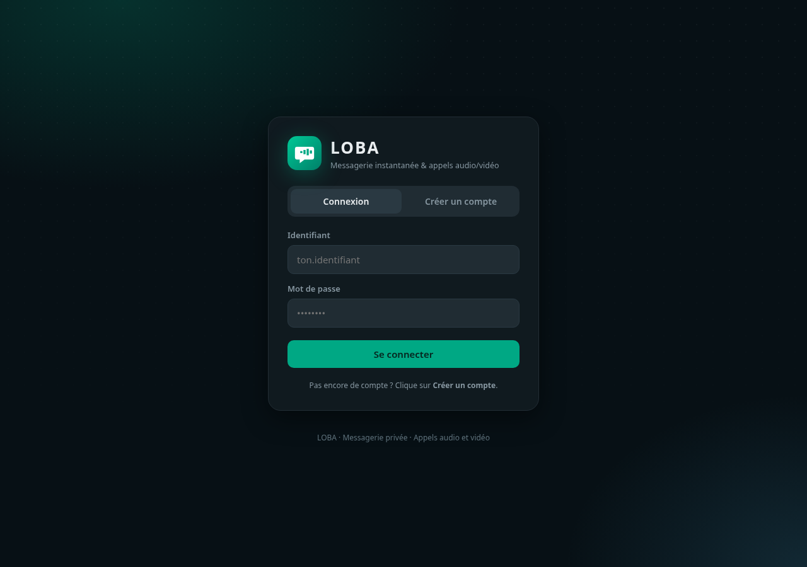
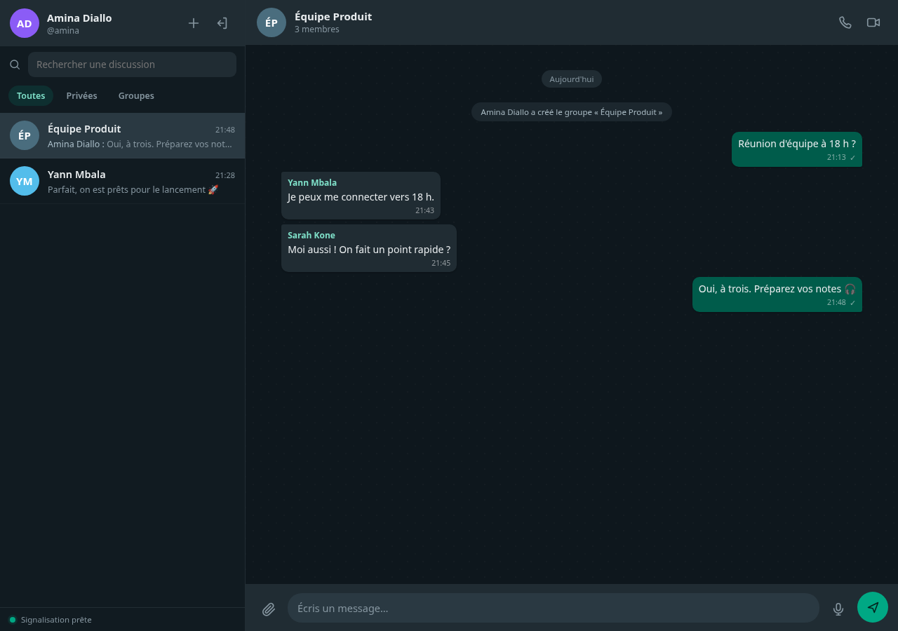

# 03 — Guide d'utilisation

Ce guide explique comment utiliser LOBA au quotidien : créer un compte,
discuter, envoyer des fichiers et des vocaux, lancer des appels privés ou de
groupe.

> Pour installer et démarrer l'application, lis d'abord
> [04 — Installation pas à pas](04-installation-pas-a-pas.md).

---

## 1. Se connecter

Ouvre **https://localhost:3000** dans ton navigateur.



### Créer un compte

Au premier lancement, clique sur l'onglet **Créer un compte**.

1. Renseigne :
   - **Nom affiché** : 2 à 40 caractères, peut contenir des accents et des
     espaces (ex. « Awa Diallo »).
   - **Identifiant** : 3 à 24 caractères, uniquement des lettres minuscules,
     chiffres, point, tiret ou underscore (ex. `awa.diallo`). Il doit être unique.
   - **Mot de passe** : 6 caractères minimum.
2. Clique sur **Créer mon compte**.

Tu es connecté automatiquement. Un cookie de session valable 30 jours est
posé dans le navigateur.

### Se reconnecter ensuite

Utilise l'onglet **Connexion** avec ton identifiant et ton mot de passe.

> **Astuce :** pour tester deux personnes sur le même ordinateur, utilise une
> fenêtre normale pour le premier compte et une **fenêtre de navigation privée**
> pour le second. Deux comptes dans le même profil partageraient le même cookie.

---

## 2. Découvrir l'interface

```
┌──────────────────────┬──────────────────────────────────────────────────┐
│  Ton avatar + nom    │  Nom de la conversation                          │
│  [+ Nouvelle disc.]  │  présence / « en train d'écrire »                │
│  [Se déconnecter]    │  [📞] [🎥]                                       │
├──────────────────────┤                                                  │
│  Rechercher…         │                                                  │
│  [Tout] [Non lus]    │              Messages                            │
│                      │                                                  │
│  ▸ Équipe Produit    │                                                  │
│  ▸ Yann Mbala        │                                                  │
│    (aperçu, heure)   │                                                  │
│                      │  ┌────────────────────────────────────────────┐  │
│                      │  │ 📎  Écris un message…        🎤  ➤        │  │
│                      │  └────────────────────────────────────────────┘  │
└──────────────────────┴──────────────────────────────────────────────────┘
```

| Élément | Rôle |
|---|---|
| **+ Nouvelle discussion** | Chercher un utilisateur ou créer un groupe |
| **Rechercher une discussion** | Filtrer la liste par nom |
| **Tout / Non lus** | Afficher toutes les discussions ou seulement les non-lues |
| **📞** | Lancer un appel audio |
| **🎥** | Lancer un appel vidéo |
| **📎** | Envoyer un fichier (image, PDF, document…) |
| **🎤** | Enregistrer un message vocal |
| **➤** | Envoyer le message texte |
| **Se déconnecter** | Fermer la session |

Le point vert à côté d'un nom indique que la personne est **en ligne**. Son
absence signifie « hors ligne » ; la dernière connexion s'affiche dans l'en-tête
de la discussion (« vu il y a 5 min »).

---

## 3. Discuter en privé

1. Clique sur **+** (à côté de ton avatar).
2. Dans la modale, cherche un utilisateur par nom ou identifiant.
3. Clique sur son nom.

La discussion privée s'ouvre. Si elle existait déjà, LOBA la réutilise : il ne
peut y avoir qu'**une seule discussion privée par paire de personnes**.

### Envoyer un message

- Écris dans le champ du bas, puis appuie sur **Entrée** ou clique sur **➤**.
- **Maj + Entrée** insère un retour à la ligne.
- Les messages font 4000 caractères maximum.
- Les liens ne sont pas transformés automatiquement en cliquables.

Le message apparaît immédiatement chez toi et chez l'autre personne grâce à
Socket.IO. Il est stocké dans PostgreSQL : il sera toujours là après un
redémarrage.

### Indicateur de frappe

Quand tu écris, l'autre personne voit « Amina est en train d'écrire… ». Rien
n'est stocké : l'indicateur disparaît après 2 secondes sans frappe.

### Messages non lus

Le compteur à droite de la conversation indique le nombre de messages non lus.
Il est calculé à partir de `last_read_at` et se remet à zéro quand tu ouvres la
discussion.

---

## 4. Créer un groupe

1. Clique sur **+**.
2. Dans la section **Créer un groupe**, saisis un nom (1 à 60 caractères).
3. Coche au moins un participant.
4. Clique sur **Créer le groupe**.



Le groupe apparaît dans la liste. Un message système indique qui l'a créé.
Tous les membres voient le groupe immédiatement, même s'ils sont en ligne au
moment de la création (événement `conversation:new`).

> **Limite actuelle :** on ne peut pas ajouter ou retirer des membres après la
> création, ni quitter un groupe depuis l'interface. Cela se fait en base ou
> serait à ajouter (voir [06 — Aller plus loin](06-aller-plus-loin.md)).

---

## 5. Envoyer des fichiers

1. Ouvre une conversation.
2. Clique sur **📎**.
3. Choisis un fichier (25 Mo maximum par défaut).

Selon le type :

| Type | Affichage dans le chat |
|---|---|
| Image PNG, JPEG, GIF, WebP, AVIF | Aperçu cliquable |
| Audio / vidéo | Lecteur intégré |
| PDF, Word, ZIP, SVG, autres | Carte avec nom, taille et bouton de téléchargement |

Le fichier est stocké dans **MinIO**, pas dans la base. Un membre de la
conversation peut le télécharger ; une personne extérieure reçoit une erreur
`403`.

> **Pourquoi les SVG ne s'affichent-ils pas ?** Un SVG peut contenir du
> JavaScript. Pour éviter une faille XSS, LOBA le traite comme un fichier à
> télécharger, jamais comme une image affichée.

---

## 6. Envoyer un message vocal

1. Clique sur **🎤**. Le navigateur demande l'accès au micro la première fois.
2. Parle. Le minuteur s'affiche.
3. Clique sur **Envoyer** pour terminer et envoyer.
4. Clique sur **Annuler** pour supprimer l'enregistrement.

Le vocal est envoyé comme un fichier audio (`kind = 'voice'`) avec sa durée.
Il s'affiche avec un lecteur et peut être réécouté par tous les membres.

Si le navigateur refuse le micro, autorise-le dans les paramètres du site
(icône à gauche de la barre d'adresse).

---

## 7. Lancer un appel audio ou vidéo

### Appel privé

1. Ouvre la discussion avec la personne.
2. Clique sur **📞** (audio) ou **🎥** (vidéo).
3. Autorise le micro (et la caméra) si le navigateur le demande.
4. Chez l'autre personne, une sonnerie retentit et une modale s'affiche.
5. Elle clique sur le bouton **vert** pour accepter, ou **rouge** pour refuser.

Pendant l'appel :

| Bouton | Effet |
|---|---|
| 🎤 barré | Couper / réactiver ton micro |
| 🎥 barré | Couper / réactiver ta caméra (appel vidéo) |
| 📞 raccrocher | Terminer l'appel pour tout le monde |

La durée de l'appel s'affiche en haut. Un appel sans réponse se termine
automatiquement au bout de **45 secondes**.

### Appel de groupe

1. Ouvre la discussion de groupe.
2. Clique sur **📞** ou **🎥**.
3. Tous les membres **en ligne** reçoivent la sonnerie.
4. Ceux qui acceptent rejoignent l'appel.

Chaque participant est connecté directement à tous les autres (maillage). LOBA
est prévu pour **2 à 4 participants**. Au-delà, la qualité peut se dégrader.

> Si plusieurs membres refusent ou ne répondent pas, l'appel continue avec
> ceux qui ont accepté. Si tout le monde quitte, il se termine.

### Bon à savoir

- **Deux navigateurs différents** (Chrome + Firefox) sont préférables : certains
  systèmes n'autorisent qu'une seule utilisation de la caméra à la fois.
- En cas de refus d'accès au micro/caméra, l'appel est automatiquement refusé.
- La tonalité d'appel sortant (« bip… bip… ») est générée par le navigateur.
- Le serveur ne voit ni le son ni l'image : ils passent directement entre les
  navigateurs.

---

## 8. Tester à deux sur le même ordinateur

C'est le scénario le plus simple pour vérifier que tout fonctionne.

1. **Fenêtre normale** : crée et connecte le premier compte.
2. **Fenêtre privée** : crée et connecte le second compte.
3. Le premier compte ouvre la discussion avec le second.
4. Envoie un message : il doit apparaître chez l'autre sans recharger.
5. Clique sur **📞**.
6. L'autre personne accepte.
7. Parlez : le son doit circuler dans les deux sens.
8. Raccroche : les deux interfaces reviennent à la discussion.

Si tu n'as qu'un seul micro, utilise un casque pour éviter l'effet Larsen
(l'écho strident dû au retour du haut-parleur dans le micro).

### Tester depuis un téléphone

1. Au démarrage, LOBA affiche une adresse du type
   `https://192.168.1.42:3000`.
2. Connecte le téléphone au **même Wi-Fi**.
3. Ouvre l'adresse, accepte l'avertissement de certificat.
4. Crée un compte ou connecte-toi avec un autre compte.

Si l'adresse ne répond pas, autorise le port 3000 dans le pare-feu de
l'ordinateur.

---

## 9. Se déconnecter

Clique sur l'icône de déconnexion en haut à gauche. Le serveur supprime la
session en base et efface le cookie. Les autres onglets du même navigateur
seront aussi déconnectés à leur prochaine action.

La déconnexion ne supprime **ni les messages ni les fichiers**.

---

## 10. Raccourcis et petits détails

| Action | Comment |
|---|---|
| Envoyer | `Entrée` |
| Nouvelle ligne | `Maj + Entrée` |
| Fermer une modale | Cliquer sur le fond sombre |
| Recharger les conversations | Rouvrir l'application ou cliquer sur le logo |
| Réessayer la signalisation | Cliquer sur l'indicateur en bas de la barre latérale |
| Voir qui est en ligne | Point vert à côté du nom |

### Que se passe-t-il si je ferme l'onglet pendant un appel ?

La connexion Socket.IO se ferme, le serveur te retire de l'appel et prévient
les autres (`call:peer-left`). En appel privé, l'appel se termine. En groupe,
les autres continuent.

### Et si je perds Internet ?

Socket.IO tente de se reconnecter automatiquement. À la reconnexion, les
conversations sont rechargées. Un appel en cours ne survit pas à une coupure
réseau : il faut le relancer.

---

## 11. Ce que LOBA ne fait pas (encore)

- Pas de suppression ni de modification de message.
- Pas d'accusés de lecture (« vu ») message par message.
- Pas de réactions, de réponses citées ni de messages épinglés.
- Pas de notifications système (uniquement le compteur et le titre de l'onglet).
- Pas de recherche dans l'historique des messages.
- Pas d'ajout/retrait de membres dans un groupe.
- Pas d'appels vers des personnes hors ligne (pas de notification push).

Ces idées sont détaillées dans
[06 — Aller plus loin](06-aller-plus-loin.md#7-idées-de-fonctionnalités).

---

## 12. En cas de problème

| Symptôme | Réflexe |
|---|---|
| Le message ne part pas | Vérifie que le serveur tourne et que tu es toujours connecté |
| Pas de sonnerie | Clique d'abord dans la page (déverrouillage audio), vérifie le volume |
| Le micro est refusé | Autorise le site dans le navigateur, vérifie que l'URL est en `https://` |
| « Signalisation indisponible » | Recharge la page, vérifie le port 3000 et le pare-feu |
| L'appel sonne mais pas de son | Réseau trop restrictif : un serveur TURN est nécessaire |
| Fichier refusé | Taille supérieure à 25 Mo ou MinIO arrêté |

Le guide complet : [05 — Dépannage](05-depannage.md).
